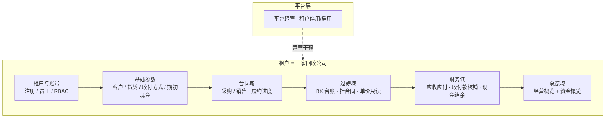
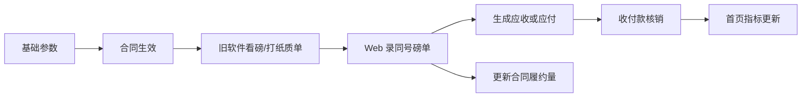
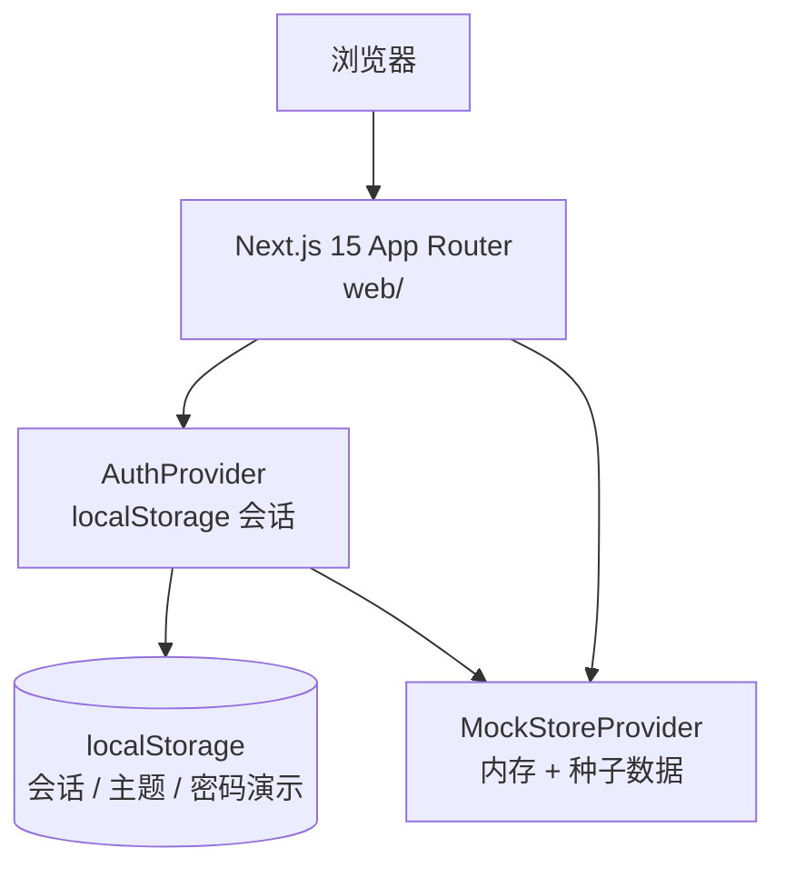
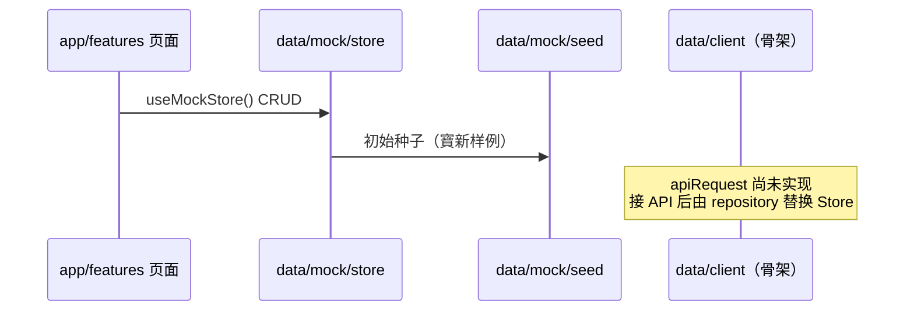
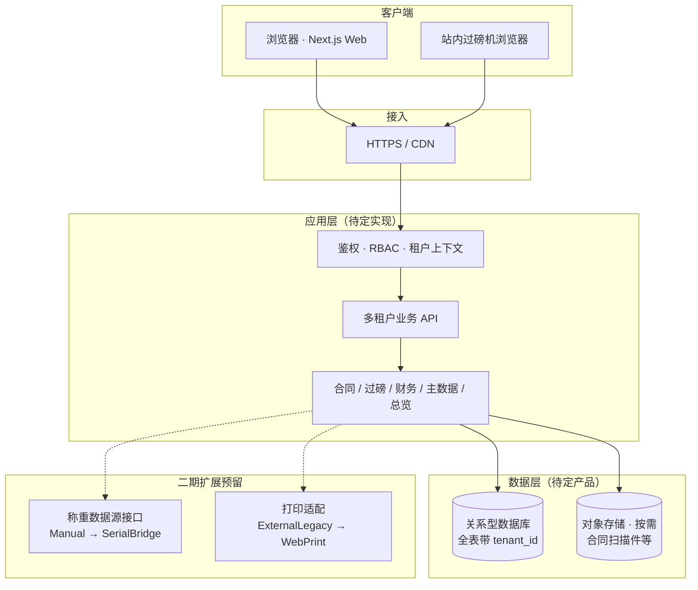
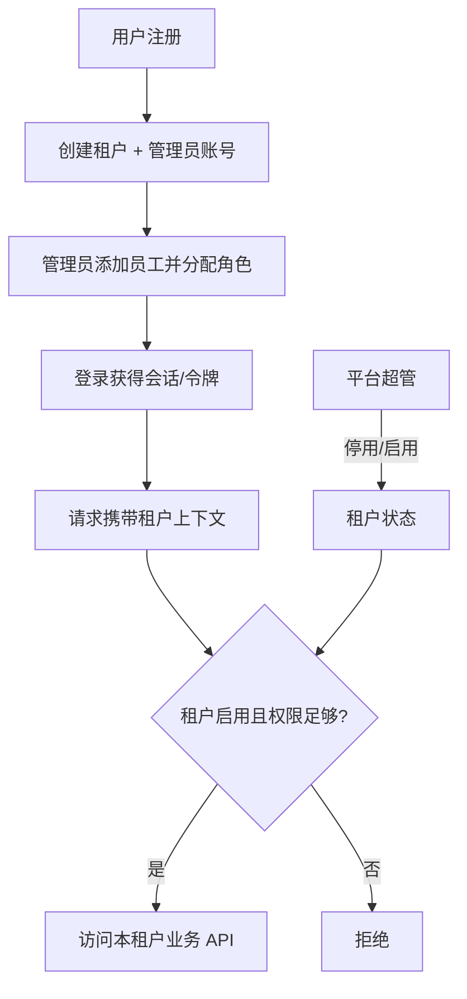
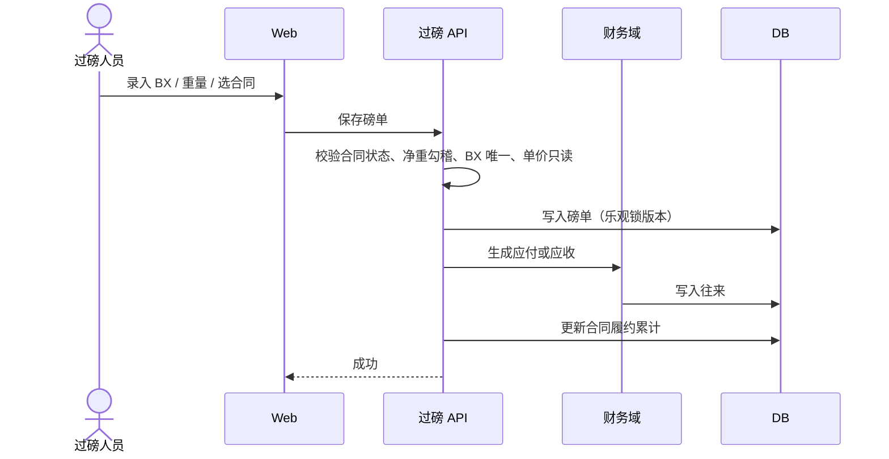
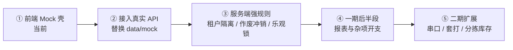

# 金属回收管理系统 — 技术架构

| 项目 | 说明 |
|------|------|
| 文档版本 | V1.0 |
| 日期 | 2026-08-06 |
| 文档状态 | 活文档（现状 + 目标演进双轨） |
| 产品形态 | 云端 Web 多租户 SaaS |
| 首个验证租户 | 寶新金屬回收有限公司（香港） |
| 关联需求 | [一期项目需求文档](./金属回收管理系统-一期项目需求文档.md) |
| 关联设计规格 | [SaaS 设计规格](./superpowers/specs/2026-08-05-metal-recycling-saas-design.md) |
| 前端实现说明 | [web/README.md](../web/README.md) |

---

## 0. 维护原则

1. **双轨分写**：§4「当前实现」只描述仓库里已落地的事实；§5「目标演进」描述规划架构与约束，**不得写成已上线能力**。
2. **规划不臆造选型**：后端框架、数据库产品等在未确认前标注「待定」，只锁定业务与质量约束。
3. **变更同步**：目录分层、数据访问方式或部署形态变化时，优先更新本文件，再更新 `web/README` 与相关规格。
4. **单一事实源**：业务规则以需求文档与设计规格为准；本文件侧重技术结构、依赖方向与演进路径。

---

## 1. 系统定位与边界（共用）

### 1.1 定位

面向金属回收行业的 **多租户云端管理系统**：以 **合同为中心** 约束单价与履约，用过磅台账替代 Excel，用往来收付管理营收与资金。首期以寶新验证，后续按同一行业模板服务多家公司。

### 1.2 一期边界

| 纳入（首批上线） | 明确不做 / 后置 |
|------------------|-----------------|
| 自助注册开户、员工、五类可配角色 | 完整会计凭证总账 |
| 客户 / 货类 / 收付方式 / 期初现金 | 跨租户老板总览 |
| 采购/销售合同与履约 | 多币种（默认单一 HKD） |
| 手录过磅台账（BX 同号对齐纸质单） | 地磅串口自动读数（二期） |
| 应收应付自动生成、收付款核销 | Web 套打取代旧软件（二期） |
| 首页经营 + 资金概览 | 分拣入库 / 精细库存成本（二期） |
| 双轨打印：旧软件打纸质单 + Web 电子台账 | 一期后半段：完整报表、杂项开支并入现金流水 |

### 1.3 运行环境（目标共识）

- 云服务器部署，HTTPS 访问
- 现代浏览器；站内过磅电脑与外出设备均可登录
- 界面：繁体中文为主，关键字段可带英文（对齐纸质磅单）；前端已支持繁/简/英切换

---

## 2. 业务域划分（共用）

### 2.1 逻辑域



### 2.2 主数据流



核心硬规则（服务端必须最终enforce，前端原型已部分体现）：

| 编号 | 规则 |
|------|------|
| R01 | 过磅必须关联「生效 / 履约中」合同 |
| R02 | 单价仅来自合同明细，过磅页不可改 |
| R03 | 净重 = 总重 − 皮重 − \|扣减\| |
| R04 | 多货类行净重之和 = 本单过磅净重 |
| R05 | 租户内 BX 单号唯一，与纸质单对齐 |
| R06 | 采购 → 应付；销售 → 应收 |
| R07 | 已保存磅单不可改关键字段；改错须作废重录 |
| R08–R09 | 未核销作废同步关闭往来；有核销须先冲销再作废 |
| R10 | 履约达约重 90% 警告；超约重默认警告不硬拦（可配置） |
| R11 | 业务数据按 `tenant_id` 隔离 |
| R12 | 金额/重量使用精确小数 |

---

## 3. 逻辑分层总览

设计规格中的六层能力，与当前前端代码包大致对应如下：

| 逻辑层 | 职责 | 当前实现位置 | 目标落地位置 |
|--------|------|--------------|--------------|
| 租户与账号 | 注册、会话、员工、RBAC | `features/auth`、`features/employees`、`features/roles`、`shared/config/permissions` | 认证服务 + 租户服务 + 权限服务 |
| 基础参数 | 客户、货类、收付方式、期初现金 | `features/customers`、`features/material-types`、`settings/cash` | 主数据 API |
| 合同域 | 合同 CRUD、状态机、履约 | `features/contracts`、`entities/contract` | 合同服务 |
| 过磅域 | 磅单录入、勾稽、作废 | `features/weigh-tickets`、`entities` 相关规则 | 过磅服务 |
| 财务域 | 往来生成、核销、结余 | `features/payments`、`features/settlements`、`entities/settlement` | 财务服务 |
| 总览 | 经营 + 资金看板 | `features/dashboard` | 查询/聚合 API 或读模型 |

---

## 4. 当前实现架构

> 本节描述 **2026-08 仓库事实**：仅前端 Mock 壳，无独立后端进程。

### 4.1 形态



- 单仓前端：`web/`
- 业务状态全部在浏览器内；刷新后 Mock 数据回种子（会话等可持久化部分除外）
- `data/client` 已预留 HTTP API 骨架，**尚未实现真实请求**

### 4.2 技术栈（已落地）

| 类别 | 选型 |
|------|------|
| 框架 | Next.js 15（App Router） |
| UI | React 19 + TypeScript |
| 样式 | Tailwind CSS 4 |
| 图标 | Phosphor Icons |
| 数据 | 本地 TS 种子 + React Context Mock Store |
| 鉴权 | 演示级：localStorage 会话；演示账号任意密码可登 |
| 国际化 | 繁体 / 简体 / 英语（`shared/i18n`） |
| 主题 | CSS 变量 + 可切换品牌色（`shared/config/theme`） |

### 4.3 前端目录与依赖方向

```text
web/src/
├── app/                 # 路由壳（页面尽量薄）
│   ├── (auth)/          # 登录 / 注册
│   └── (app)/           # 业务页 + AppShell
├── features/            # 按业务域组织的 UI（弹窗、视图）
├── entities/            # 领域类型与纯业务规则（无 UI）
├── data/
│   ├── mock/            # 当前：store + seed
│   └── client/          # 预留：真实 API client
└── shared/              # ui / layout / config / i18n / lib / providers
```

| 层 | 职责 | 允许依赖 |
|----|------|----------|
| `app/` | 路由与页面组装 | → features / shared |
| `features/` | 业务 UI | → entities / data / shared |
| `entities/` | 领域模型与纯函数规则 | → shared（工具） |
| `data/` | Mock 或 API | → entities |
| `shared/` | 通用能力 | **不依赖** features |

### 4.4 运行时组装

根布局（`app/layout.tsx`）Provider 顺序：

```text
ThemeProvider → I18nProvider → MockStoreProvider → AuthProvider → ConfirmProvider
```

- `(app)/layout.tsx`：`AppShell` + 侧栏菜单
- 菜单定义：`shared/config/menu.ts`（应收/应付路由保留、菜单暂隐藏）
- 权限矩阵：`shared/config/permissions.ts`（模块 menu/read/write + 按钮动作）
- 演示阶段：登录后菜单能力以原型为准；角色级按钮裁剪仍在完善中

### 4.5 数据访问现状



- 磅单保存等路径中，Mock Store 已串联部分往来同步逻辑（如按磅单生成/同步应收应付、收付款核销后余额）
- 完整作废冲销、多租户隔离、乐观锁等 **以服务端最终实现为准**；原型可能未覆盖全部边界

### 4.6 模块 ↔ 路由对照（当前）

| 模块 | 路由 |
|------|------|
| 首页总览 | `/dashboard` |
| 项目全景 | `/transactions` |
| 合同管理 | `/contracts` |
| 过磅台账 | `/weigh-tickets` |
| 收付款 | `/payments` |
| 应收 / 应付 | `/receivables`、`/payables`（后台保留，菜单隐藏） |
| 客户 / 客户分类 | `/customers`、`/customers/categories` |
| 货物类型 | `/material-types` |
| 员工 / 角色 | `/employees`、`/roles` |
| 设置 | `/settings/profile`、`/password`、`/cash` |
| 登录 / 注册 | `/login`（全幅氛围）；`/login/split`（左图右表单备选）；`/register` 暂重定向至登录 |

页面级细节见 `需求文档/*.md`。

### 4.7 当前架构的已知局限

| 局限 | 说明 |
|------|------|
| 无真实后端 | 数据不持久、不共享、不可跨设备一致 |
| 租户隔离未强制 | 演示环境以单租户种子为主 |
| 鉴权为演示级 | 不可用于生产 |
| 部分业务规则仅在 UI/Mock | 接 API 后必须下沉服务端 |
| 无文件存储服务 | 合同扫描件等若本地演示，接后端需对象存储或等价方案 |

---

## 5. 目标演进架构

> 本节为 **规划目标**。后端技术选型在实现计划阶段确认；此处锁定形态与约束。

### 5.1 目标形态



### 5.2 后端约束（选型待定，约束锁定）

无论最终选用何种语言/框架，一期后端须满足：

| 约束 | 要求 |
|------|------|
| 多租户 | 业务表带 `tenant_id`；API **强制**租户上下文校验，禁止跨租户读写 |
| 开户 | 自助注册即创建租户；注册人成为系统管理员；平台超管可停用/启用租户 |
| RBAC | 预置五类角色模板，权限点可配置；菜单与按钮级授权 |
| 精确金额 | 金额/重量禁止裸浮点累加误差；使用精确小数类型 |
| 并发 | 磅单等关键写操作使用乐观锁（或等价机制），防止互相覆盖 |
| 审计 | 敏感操作（作废、冲销、期初现金调整、权限变更等）写审计日志 |
| 业务规则 | R01–R12 在服务端校验；前端校验仅提升体验，不可作为唯一关卡 |
| 币种 | 首批单一 HKD |
| 扩展 | 预留称重数据源、打印适配接口，便于二期接入 |

### 5.3 建议的服务边界（逻辑，非强制微服务拆分）

首批推荐 **模块化单体（Modular Monolith）** API，按域分包；是否拆微服务不在一期决策范围。

```text
api/
  tenant-auth/     # 注册、登录、会话、租户状态
  master-data/     # 客户、货类、收付方式、期初现金
  contracts/       # 合同状态机与履约
  weigh-tickets/   # 过磅、勾稽、作废
  finance/         # 往来生成、核销、结余
  dashboard/       # 经营/资金聚合查询
  admin-platform/  # 平台超管（停用租户等）
```

前端接入路径：业务层统一经 `data/client`（或 repository），**禁止**在 `features/` / `app/` 中直接 `fetch`。

### 5.4 多租户与鉴权（目标）



- 老板只看 **本租户** 总览，不做跨公司汇总（一期）
- 寶新与源佳等公司均为独立租户，共用行业模板

### 5.5 关键写路径（目标）



作废路径：未核销 → 关闭往来；存在核销分配 → **先冲销相关分配再作废**（冲销完成前拒绝作废）。

### 5.6 部署与运维（目标）

| 项 | 一期目标 |
|----|----------|
| 应用 | 云主机或容器部署 Web + API（可同机或分服务） |
| 数据 | 托管或自建关系库；定期备份 |
| 安全 | HTTPS、鉴权、RBAC、租户隔离、审计 |
| 可观测 | 至少具备应用日志与错误追踪（具体工具待定） |
| 文件 | 合同扫描件等按需上对象存储 |

### 5.7 一期后半段与二期（仍属规划）

| 阶段 | 内容 |
|------|------|
| 一期后半段 | 货类日汇总、对账单、月报导出；杂项开支并入现金流水 |
| 二期+ | 分拣/压缩入库；本地桥接串口读磅；Web 套打；精细库存成本与盈亏估值 |

---

## 6. 演进路径



| 阶段 | 前端 | 后端 | 完成标志 |
|------|------|------|----------|
| ① 当前 | Mock Store + 演示鉴权 | 无 | 全模块可演示 |
| ② 接 API | `data/client` 落地；UI 少改 | CRUD + 会话 + 租户头 | 数据持久且多端一致 |
| ③ 强规则 | 错误码与拒绝对齐 | R01–R12、审计、乐观锁 | 通过需求验收场景 |
| ④ 报表/杂项 | 报表页与导出 | 聚合查询、开支入流水 | 财务日结可用 |
| ⑤ 二期 | 读磅/打印适配 UI | SerialBridge、WebPrint、库存域 | 弱化纸质+Excel 双轨 |

---

## 7. 相关文档索引

| 文档 | 用途 |
|------|------|
| [一期项目需求文档](./金属回收管理系统-一期项目需求文档.md) | 业务范围、规则、验收 |
| [SaaS 设计规格](./superpowers/specs/2026-08-05-metal-recycling-saas-design.md) | 已确认产品/技术边界 |
| [前端 UI 设计规范](./superpowers/specs/2026-08-05-frontend-ui-design-system.md) | Soft UI、Token、组件约定 |
| [前端壳实现计划](./superpowers/plans/2026-08-05-frontend-shell.md) | 首批前端落地计划 |
| [web/README.md](../web/README.md) | 启动方式与目录约定 |
| [需求文档/](../需求文档/) | 各页面级 PRD |

---

## 8. 修订记录

| 版本 | 日期 | 说明 |
|------|------|------|
| V1.0 | 2026-08-06 | 初版：现状（Mock 前端）与目标演进双轨架构文档 |
