# 金属回收管理系统 — 一期项目需求文档

| 项目 | 说明 |
|------|------|
| 文档版本 | V1.0 |
| 日期 | 2026-08-05 |
| 产品形态 | 云端 Web 多租户 SaaS |
| 首个验证客户 | 寶新金屬回收有限公司（香港） |
| 关联设计规格 | [设计规格](./superpowers/specs/2026-08-05-metal-recycling-saas-design.md) |
| 文档状态 | 需求整理稿（基于已确认设计） |

---

## 1. 项目概述

### 1.1 建设背景

以寶新金屬回收有限公司为代表的金属回收企业，主营废金属收购、加工、出口。当前作业依赖：

1. **地磅 + 旧 Windows 过磅软件**：串口读重、打印纸质「秤重報告過磅單」
2. **Excel《鐵料當日磅單》**：人工誊抄当日进出场
3. **Excel《鐵料收支記錄》**：买卖、应收应付、现金结余

痛点集中在：**重复录入、单价与合同脱节、账易错、难实时看营收与资金**。

### 1.2 建设目标

建设一套面向金属回收行业的 **多租户云端管理系统**，以 **合同为中心** 约束单价与履约，用系统过磅台账替代 Excel，用往来收付管好营收与资金；首期以寶新验证，后续服务多家同类公司。

### 1.3 一期要解决的核心问题

| 编号 | 问题 | 一期对策 |
|------|------|----------|
| P1 | 单价靠手填，易与谈价不符 | 过磅必须挂合同，单价只读带出 |
| P2 | Excel 与纸质单两套账 | Web 用同一 BX 单号对齐纸质单，逐步替代 Excel |
| P3 | 应收应付、现金看不清 | 磅单自动生成往来，支持收付款核销与首页资金概览 |
| P4 | 老板难总览经营 | 首页经营概览 + 资金概览 |
| P5 | 未来要服务多家公司 | 多租户隔离；自助注册、员工与角色可配 |

### 1.4 成功标准（一期）

- 无有效合同不能落正式磅单；过磅页不能改单价
- 租户内 BX 单号与纸质单可核对
- 采购/销售过磅分别形成应付/应收，可核销收付款
- 首页同时展示经营与资金指标
- 租户数据隔离；可注册公司、加员工、配角色
- 以寶新跑通采购→过磅→付款、销售→过磅→收款全链路

---

## 2. 一期范围

### 2.1 范围总览

### 2.2 首批上线（本期需求主体）

| 模块 | 需求要点 |
|------|----------|
| 多租户与账号 | 自助注册创建公司；添加/停用员工；预置并可配置五类角色 |
| 基础参数 | 客户、货类、收付方式、期初现金等 |
| 合同 | 采购合同 / 销售合同；货类+单价+约重；履约进度 |
| 过磅 | 手录重量；挂合同；同号 BX；一单多货类；作废规则 |
| 往来收付 | 应收/应付自动生成；收付款核销；客户余额 |
| 首页 | 经营概览 + 资金概览 |
| 打印策略 | **双轨**：旧软件继续打印纸质单；Web 做电子台账 |

### 2.3 一期不做 / 二期再做

| 不做（一期） | 说明 |
|--------------|------|
| 分拣/压缩入库工序 | 二期 |
| 串口自动读磅 | 一期手录；预留扩展 |
| Web 取代旧软件套打 | 一期仍用旧软件打印 |
| 完整会计凭证总账 | 超出本期 |
| 跨公司老板总览 | 老板只看本租户 |
| 多币种 | 默认单一 HKD |

---

## 3. 角色与权限

### 3.1 角色一览

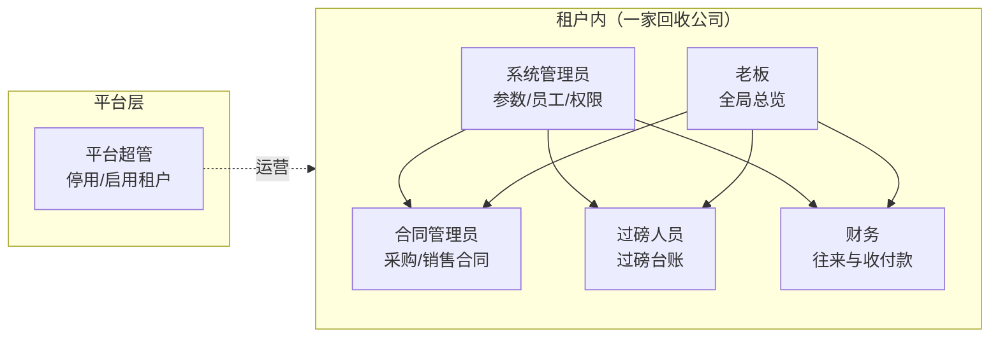

### 3.2 权限矩阵（首批）

| 能力 | 系统管理员 | 合同管理员 | 过磅人员 | 财务 | 老板 |
|------|:----------:|:----------:|:--------:|:----:|:----:|
| 员工与角色 | ● | | | | ○ |
| 基础参数 | ● | ○ | ○ | ○ | ○ |
| 合同 CRUD / 生效 | | ● | | | ○ |
| 过磅录入 / 作废申请 | | | ● | | ○ |
| 应收应付 / 收付款 | | | | ● | ○ |
| 首页经营+资金 | ○ | ○ | ○ | ● | ● |

> ● 可操作　○ 只读或按权限点配置　空 = 默认不可见

---

## 4. 业务全景流程

### 4.1 端到端主流程（合同中心）

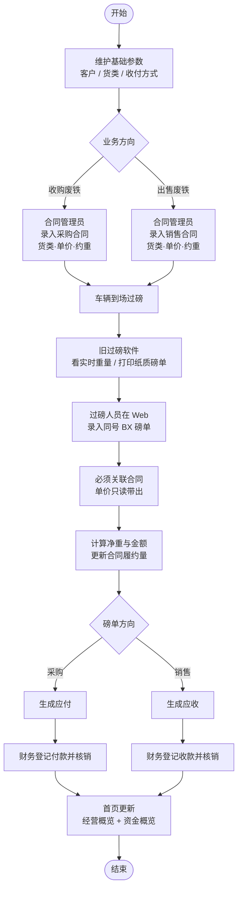

### 4.2 采购业务泳道图

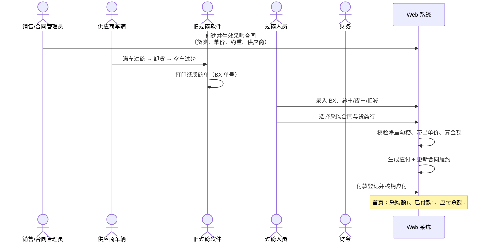

### 4.3 销售业务泳道图

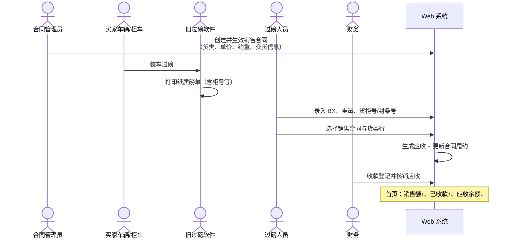

---

## 5. 分模块需求说明

### 5.1 多租户与开户

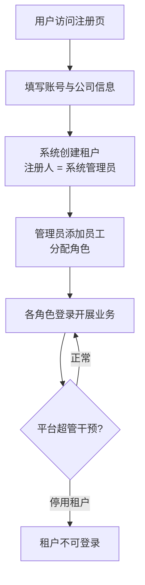

**需求要点：**

- 自助注册即开户，无需平台逐单审批开通
- 业务数据强制 `tenant_id` 隔离
- 平台超管可停用/启用租户，默认不查看业务明细

### 5.2 基础参数

| 主数据 | 说明 |
|--------|------|
| 客户/供应商 | 名称、分类（出口/船/大判/分判/中商/行家等，可配）、联系方式 |
| 货类 | AA、A、AB、B、PNS、工字等，租户可维护；区分采购/销售可用 |
| 收付方式 | 现金、支票、转账等 |
| 期初现金 | 启用时录入一次（HKD）；调整记审计日志 |
| 单号规则 | 与现场 BX 纸质单号对齐录入（首批以手工录入纸质单号为主） |

### 5.3 合同管理

#### 5.3.1 合同状态机

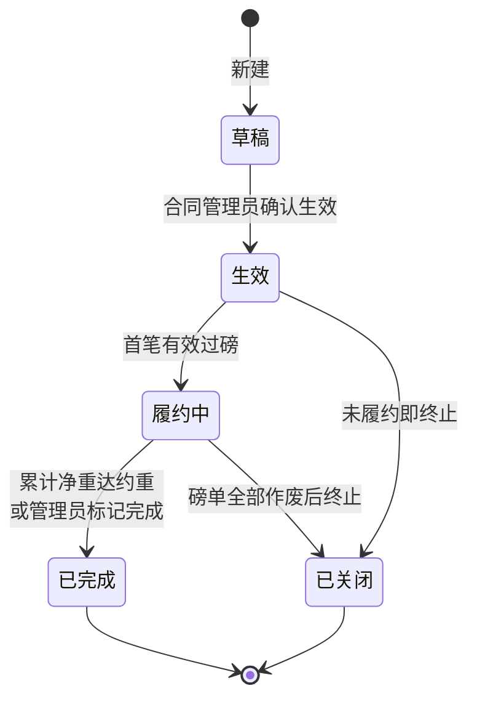

#### 5.3.2 合同 → 多车履约

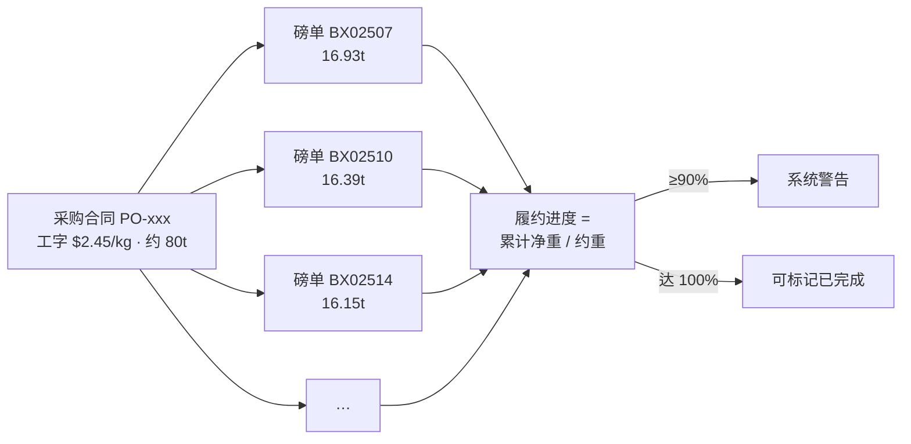

**需求要点：**

- 类型：采购合同 / 销售合同
- 明细：货类、单价（HKD/kg）、约定重量等
- 仅「生效 / 履约中」可选入过磅
- 无合同不得过磅；散户先建「当日价/临时合同」
- 超约重默认警告不硬拦（可配置）

### 5.4 过磅台账

#### 5.4.1 双轨过磅作业流

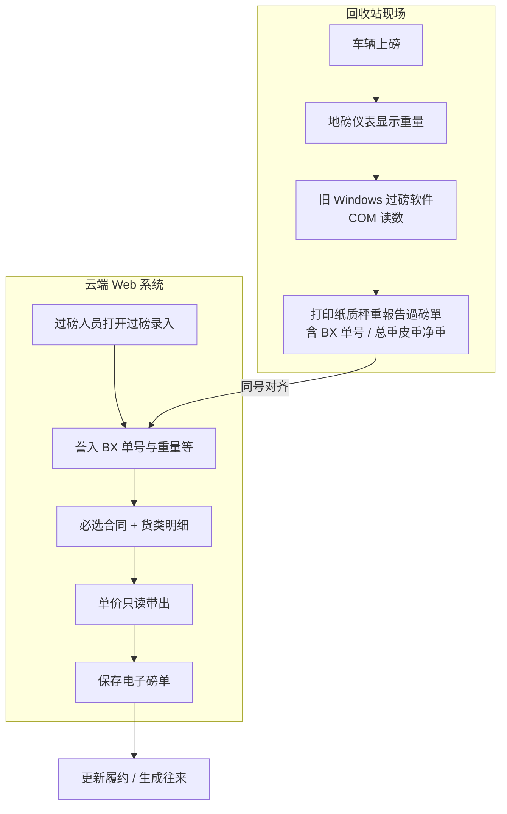

#### 5.4.2 重量与金额规则

| 规则 | 公式 / 说明 |
|------|-------------|
| 净重 | 总重 − 皮重 − \|扣减\| |
| 多货类 | Σ 各行净重 = 本单过磅净重，否则拒存 |
| 金额 | 行净重 × 合同单价 |
| 单价 | 仅来自合同，过磅页不可改 |
| 方向 | 采购 / 销售（决定往来类型） |
| 出口字段 | 货柜号、封条号等 |

#### 5.4.3 保存后修改与作废

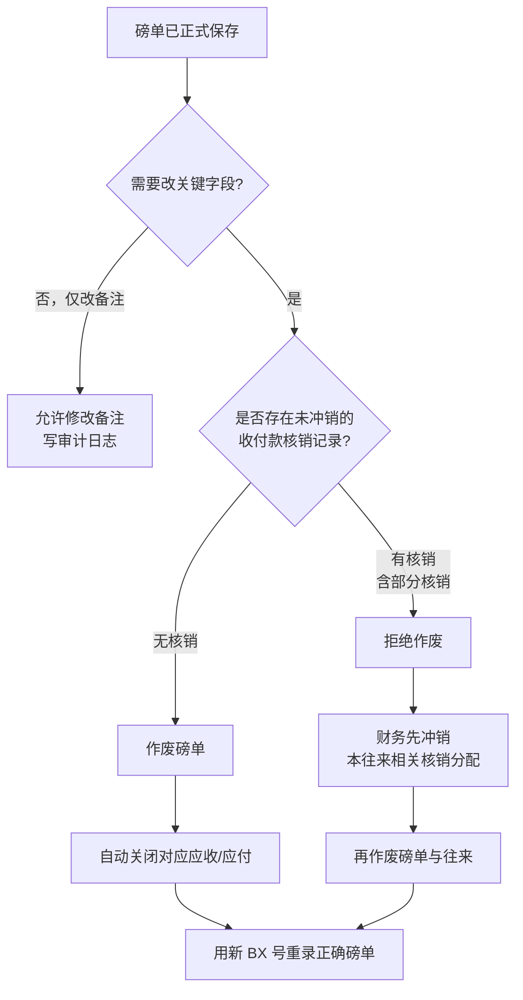

> 一笔收付若核销了多笔往来：冲销时只解除与本往来相关的分配，不整单作废该收付款。

### 5.5 往来与收付款

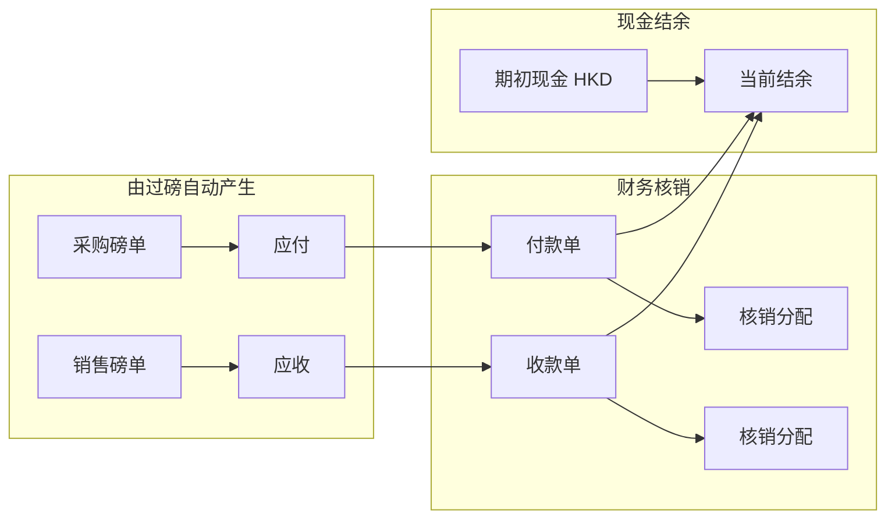

**需求要点：**

- 一磅单对应一笔往来（金额为各货类行合计）
- 一笔收/付款可核销多笔往来
- 收付方式：现金 / 支票 / 转账等 + 凭证号 + 备注
- 币种：单一 HKD
- 现金结余 ≈ 期初 + 本期收款 − 本期付款（杂项开支放一期后半段）

### 5.6 首页营收总览

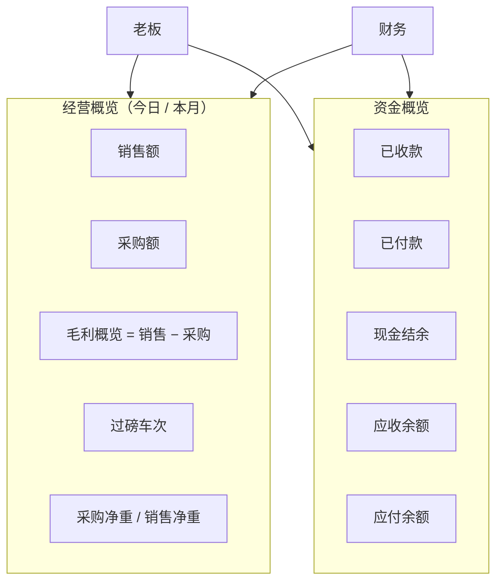

---

## 6. 关键业务规则汇总

| 编号 | 规则 |
|------|------|
| R01 | 过磅必须关联「生效/履约中」合同 |
| R02 | 过磅页单价只读，来源于合同明细（一次性合同模型下合同是价格正源；价格谈变先走合同改价，见《合同价差调整》PD10/PD11） |
| R03 | 净重 = 总重 − 皮重 − \|扣减\| |
| R04 | 多货类行净重之和必须等于过磅净重 |
| R05 | 租户内 BX 单号唯一，与纸质单对齐 |
| R06 | 采购 → 应付；销售 → 应收 |
| R07 | 已保存磅单不可改关键字段；改错须作废重录 |
| R08 | 未核销作废 → 自动关闭往来 |
| R09 | 有核销（含部分）→ 先冲销相关分配再作废 |
| R10 | 合同履约达约重 90% 警告；超约重默认警告 |
| R11 | 所有业务数据按租户隔离 |
| R12 | 金额/重量使用精确小数，避免浮点误差 |

---

## 7. 非功能需求（一期）

| 类别 | 要求 |
|------|------|
| 部署 | 云服务器，HTTPS 访问 |
| 客户端 | 现代浏览器；站内过磅电脑与外出设备均可登录 |
| 语言 | 繁体中文为主，关键字段带英文（对齐现有磅单） |
| 安全 | 登录鉴权、RBAC、租户隔离、敏感操作审计 |
| 并发 | 磅单保存乐观锁，防止互相覆盖 |
| 扩展 | 预留称重数据源、打印适配接口，便于二期接串口与 Web 套打 |

---

## 8. 验收要点（首批）

| 场景 | 期望结果 |
|------|----------|
| 新公司注册并加员工 | 租户隔离正确，角色菜单正确 |
| 采购合同 → 多车过磅 → 付款 | 履约量、应付、结余、首页正确 |
| 销售合同 → 过磅（含柜号）→ 收款 | 应收、结余、首页正确 |
| 一单多货类 / 扣减 | 勾稽错误拒存；正确则金额对 |
| 未核销作废 | 往来自动关闭 |
| 部分核销后作废 | 未冲销前拒作废；冲销后可作废 |
| 跨租户访问 | 拒绝 |
| 无合同过磅 | 拒绝保存 |

---

## 9. 与现有现场资料的对应

| 现场资料 | 系统对应 |
|----------|----------|
| 纸质秤重報告過磅單 | 电子磅单字段 + BX 同号；打印暂留旧软件 |
| Excel 鐵料當日磅單 | 过磅台账 |
| Excel 鐵料收支記錄 | 磅单方向 + 往来收付（系统用明确方向字段，不用正负 KG 歧义） |
| 客户分类（出口/船/大判…） | 客户主数据属性 |
| 源佳账本逻辑 | 与寶新相同行业模板；各为独立租户 |

---

## 10. 术语表

| 术语 | 含义 |
|------|------|
| 租户 | 一家使用本系统的金属回收公司 |
| 采购合同 | 向供应商收购废金属的约定（含单价） |
| 销售合同 | 向买家出售废金属的约定（含单价） |
| 磅单 / BX | 一次过磅业务单据，单号与纸质单对齐 |
| 扣减 | 扣杂、扣泥等重量扣减 |
| 应收 | 销售后客户应付给本公司的款项 |
| 应付 | 采购后本公司应付给供应商的款项 |
| 核销 | 将收/付款与应收/应付进行匹配结清 |
| 双轨 | 旧软件打印 + Web 台账并行过渡 |

---

## 11. 附录：模块关系总图

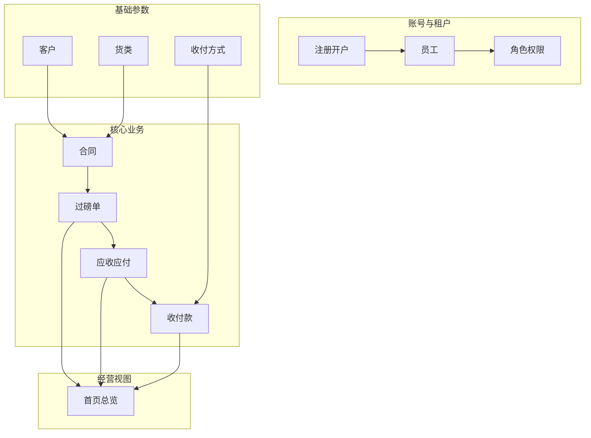

---

**文档说明：** 本文档整理一期（以首批上线为主体）的产品需求与业务流程可视化说明，细节规则与设计规格保持一致。若本文与设计规格冲突，以双方评审后的更新版为准。
